# QUINOR · Control de despacho: manual de usuario

Versión del 15/11/2026. Describe el dashboard después de la mejora de UX
(menú lateral, bandeja con filtros a la vista, página propia del evento, pesada
por pasos y confirmaciones).

Las capturas se generaron con datos de ejemplo: los clientes, las órdenes y los
pesos que aparecen son inventados.

## 1. Quién puede hacer qué

| Rol | Puede |
|---|---|
| Consulta | Ver eventos, pesadas, órdenes, cámaras, estado y tolerancias. No registra ni clasifica |
| Supervisor | Lo anterior, y además registrar pesadas y clasificar eventos |
| Administrador | Lo anterior, y además cambiar tolerancias, administrar usuarios y revocar tokens |

## 2. Iniciar sesión

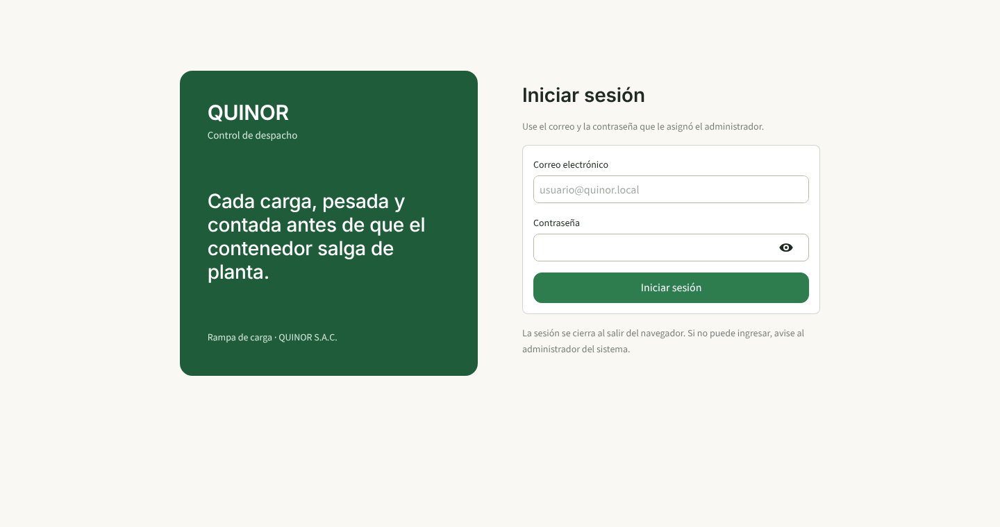

1. Escriba el correo y la contraseña que le asignó el administrador.
2. Pulse **Iniciar sesión**. El icono del ojo muestra la contraseña escrita.

La sesión se cierra al salir del navegador. Si aparece "No hay conexión con el
sistema", espere unos segundos y vuelva a intentarlo; si continúa, avise al
administrador.

## 3. Orientarse: el menú y la línea de estado

El menú de la izquierda tiene tres grupos:

- **Operación:** Eventos, Registro de pesada, Órdenes.
- **Monitoreo:** Cámaras, Estado del sistema.
- **Administración:** Tolerancias, Tokens de acceso y, solo para el
  administrador, Usuarios.

El número junto a **Eventos** indica cuántos esperan revisión, y se ve desde
cualquier pantalla.

Arriba de cada pantalla hay una línea de estado. En verde dice "Sistema en
línea" y cuántas cámaras graban. **En rojo nombra el componente que falla**
(una cámara, la báscula); en ese caso abra **Estado del sistema**.

Debajo del menú están su nombre, **Actualizar datos** y **Cerrar sesión**.

## 4. Eventos: la bandeja

Un evento es una pesada cuya diferencia con el peso esperado superó la
tolerancia del producto.

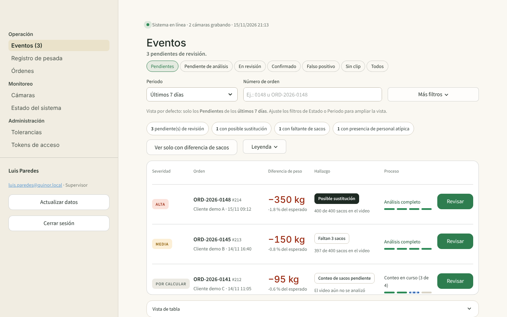

### Filtrar

- **Estado:** las etiquetas de arriba. Por defecto, *Pendientes*.
- **Periodo** y **Número de orden:** siempre a la vista. Por defecto, los
  últimos 7 días.
- **Más filtros:** severidad, solo cargas con diferencia de sacos y eventos por
  página. El botón indica cuántos hay activos.

Debajo, un resumen de lo que hay en pantalla. Los botones **Ver solo…** aplican
ese filtro con un clic.

### Leer una fila

| Elemento | Qué significa |
|---|---|
| Severidad | Alta, Media o Baja. "Sin severidad" si el análisis no terminó |
| Cifra en rojo | Diferencia entre el peso real y el esperado |
| Etiqueta de hallazgo | **Posible sustitución:** falta peso y los sacos cuadran. **Faltan N sacos:** el video contó menos sacos que la orden. **Conteo de sacos pendiente:** el video aún no se analizó |
| Proceso | "Análisis completo" cuando el sistema terminó. Si no, dice en qué paso va (Pesada, Video, Conteo, Análisis) o qué falló. La barra de debajo lo resume: verde, hecho; azul, en curso; gris, pendiente |

Pulse **Revisar** para abrir el evento. **Vista de tabla** muestra los
mismos eventos en una tabla, y la paginación está al pie.

## 5. Revisar y clasificar un evento

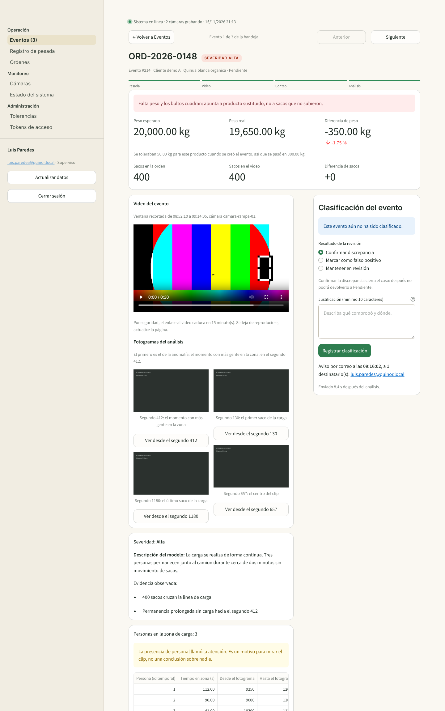

1. Lea el aviso rojo, si lo hay: resume el hallazgo principal.
2. Compare las cifras. La diferencia de peso aparece en rojo, falte o sobre.
3. Mire el video. Los botones **Ver desde el segundo…**, bajo cada fotograma,
   llevan el video a ese momento.
4. Lea lo que observó el análisis y cuántas personas estuvieron en la zona. Los
   identificadores de persona son temporales y no corresponden a nadie en
   concreto.
5. A la derecha, elija el **resultado de la revisión**, escriba la
   justificación (mínimo 10 caracteres) y pulse **Registrar clasificación**.

| Resultado | Cuándo usarlo |
|---|---|
| Confirmar discrepancia | Comprobó que la diferencia es real. **Cierra el caso: después no puede volver a Pendiente** |
| Marcar como falso positivo | La carga era correcta |
| Mantener en revisión | Falta verificar algo antes de decidir |

**Anterior** y **Siguiente** recorren los eventos de la bandeja sin volver a
ella. **Volver a Eventos** regresa a la bandeja con los filtros que tenía.

Si el video no se reproduce, ábralo en Chrome o Edge. El enlace caduca a los
pocos minutos por seguridad: actualice la página para renovarlo.

## 6. Registrar una pesada

La pantalla avanza en tres pasos y solo muestra el que toca.

### Paso 1: la orden

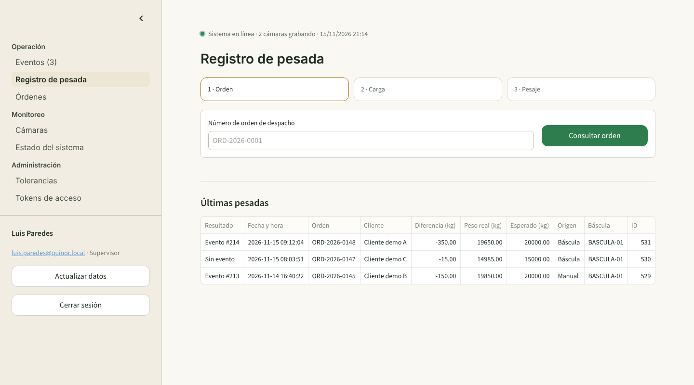

Escriba el número de orden y pulse **Consultar orden**. La orden queda resumida
arriba; **Cambiar orden** vuelve a este paso.

### Paso 2: la carga

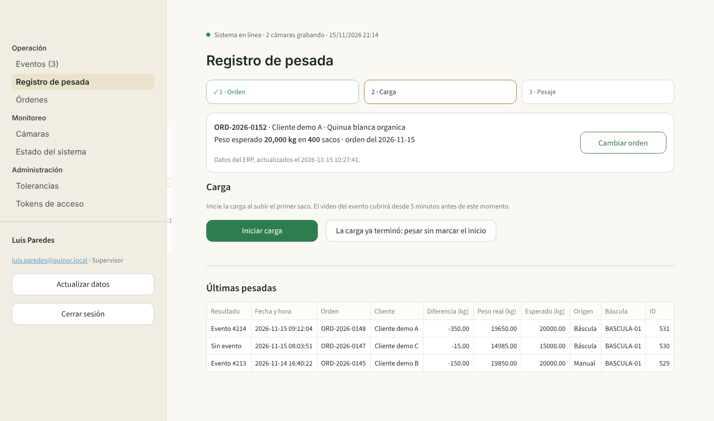

Pulse **Iniciar carga** cuando suba el primer saco. El video del evento cubrirá
desde cinco minutos antes de ese momento.

Si la carga ya terminó y nadie marcó el inicio, use **La carga ya terminó:
pesar sin marcar el inicio**. La pesada se registra igual, pero el video solo
cubrirá los cinco minutos previos al cierre.

### Paso 3: el pesaje

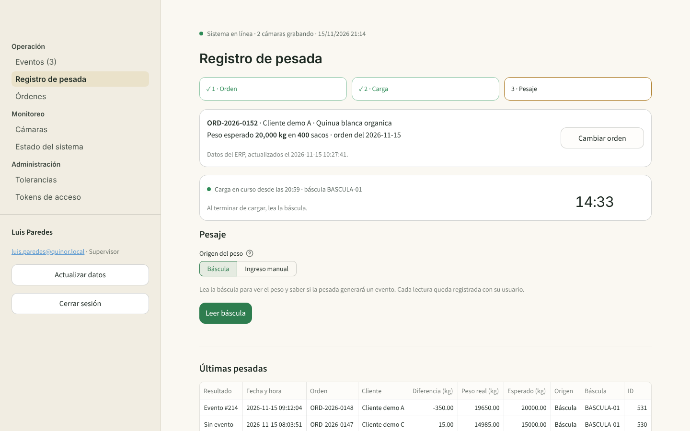

1. Al terminar de cargar, pulse **Leer báscula**.
2. La pantalla muestra el peso, la diferencia con la orden y si la pesada
   generará un evento.

   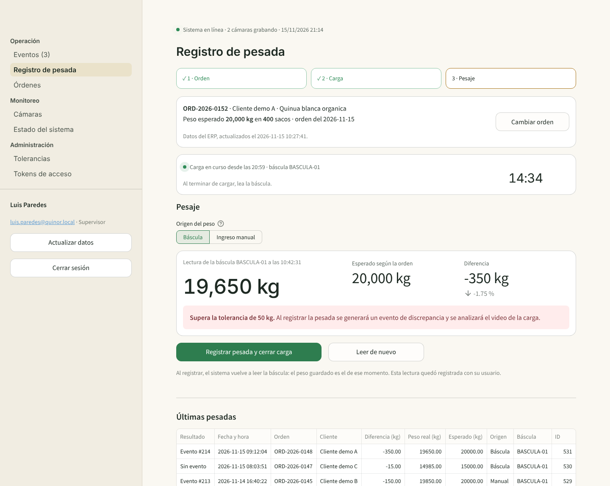

3. Pulse **Registrar pesada y cerrar carga**. Si la báscula sigue en
   movimiento, espere y use **Leer de nuevo**.

Dos cosas importantes:

- **Cada lectura de la báscula queda registrada con su usuario**, aunque
  después no registre la pesada.
- **Al registrar, el sistema vuelve a leer la báscula.** El peso guardado es el
  de ese momento, no el que se mostró antes.

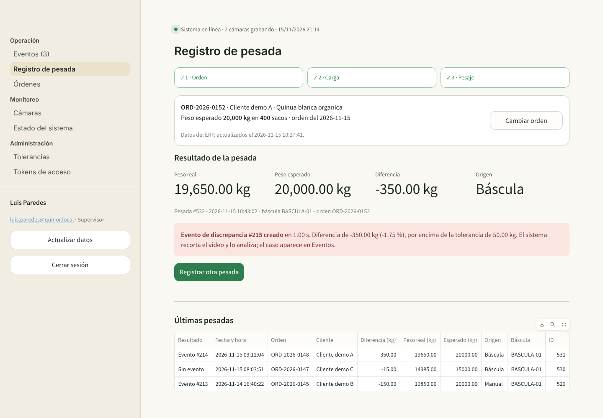

Si la diferencia supera la tolerancia, el sistema crea el evento, recorta el
video y lo analiza. El caso aparece en **Eventos**.

### Si la báscula no responde

Elija **Ingreso manual**, escriba el peso leído en la balanza auxiliar y el
motivo (mínimo 10 caracteres). El campo empieza vacío. El registro queda
marcado como manual, con su usuario y el motivo.

### Últimas pesadas

La tabla del pie indica en la columna **Resultado** qué pesadas abrieron un
evento.

## 7. Tolerancias

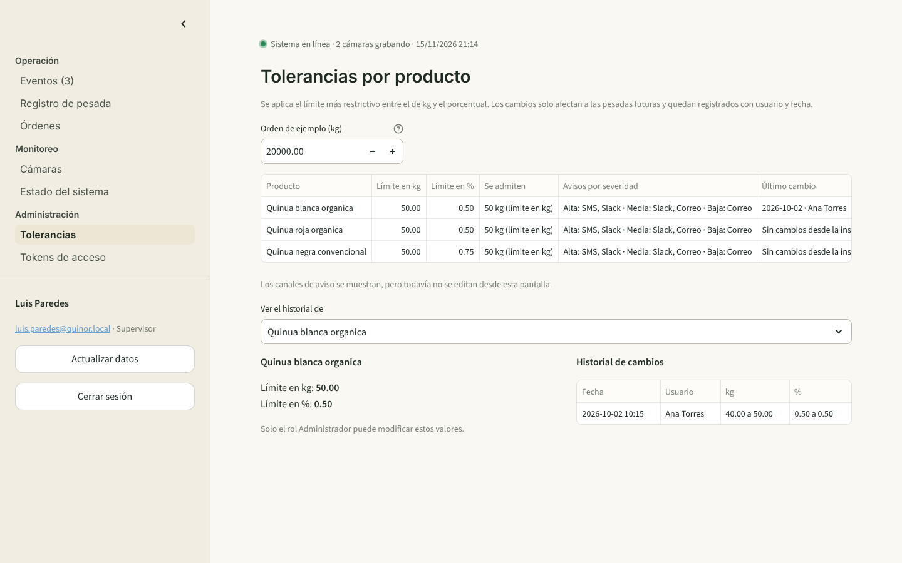

Cada producto tiene un límite en kg y otro en porcentaje; se aplica el más
restrictivo. La columna **Se admiten** traduce la regla a kilos para la orden
de ejemplo que indique arriba.

Solo el administrador puede cambiarlas:

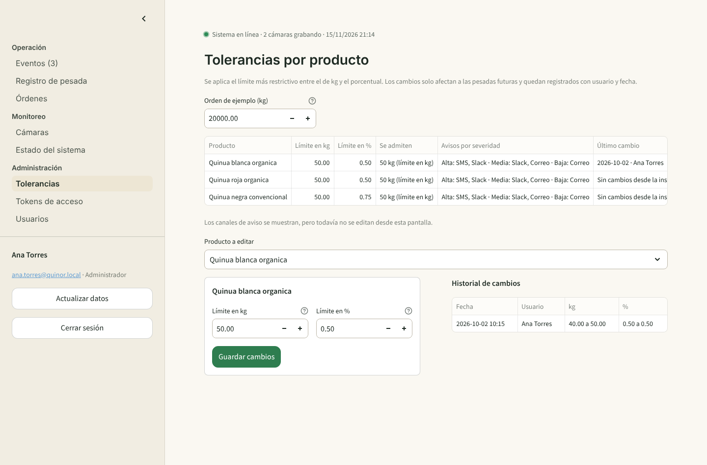

1. Elija el producto en **Producto a editar**.
2. Cambie los límites y pulse **Guardar cambios**.
3. Confirme en el cuadro, que muestra el valor anterior y el nuevo.

El cambio solo afecta a las pesadas futuras y queda en el historial con su
usuario. Los canales de aviso se muestran, pero todavía no se editan desde esta
pantalla.

## 8. Usuarios y tokens (administrador)

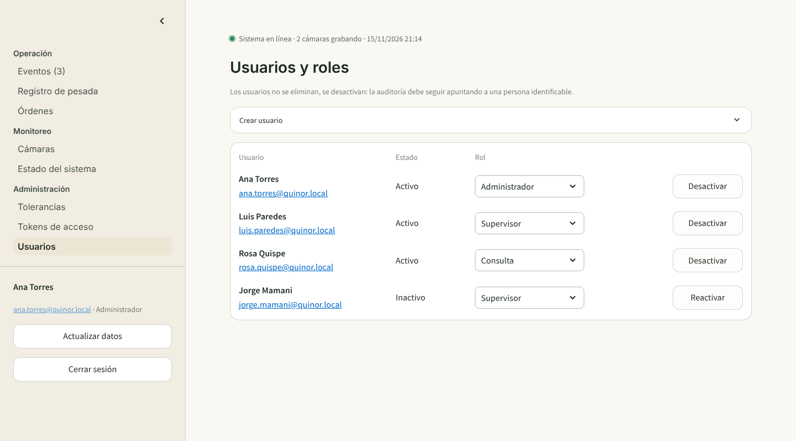

- **Cambiar un rol:** elija el rol nuevo en la lista y pulse **Aplicar rol**.
- **Desactivar o reactivar:** los usuarios no se eliminan, para que la
  auditoría siga apuntando a una persona.
- **Revocar un token:** en *Tokens de acceso*. Deja de servir de inmediato y no
  se puede deshacer.

Todas estas acciones piden confirmación antes de aplicarse:

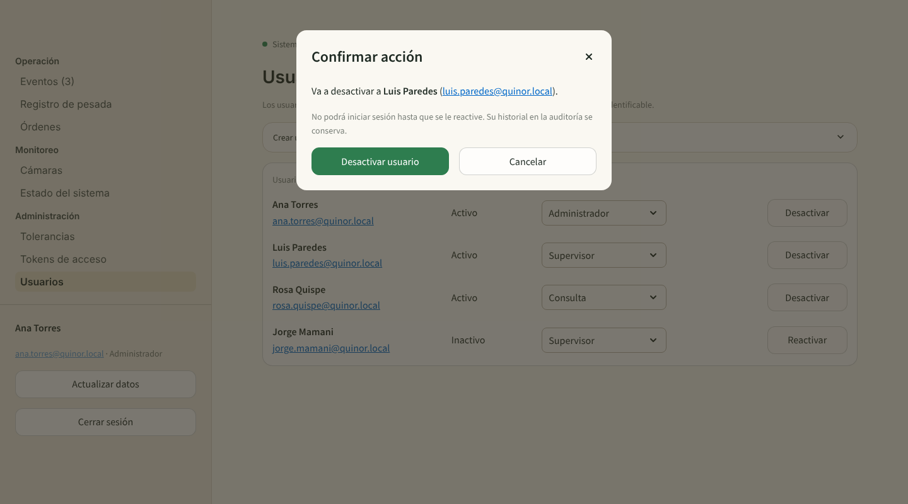

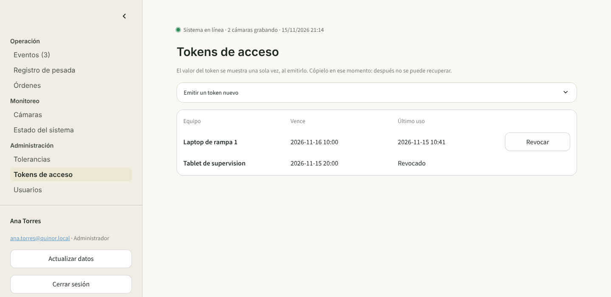

El valor de un token nuevo se muestra una sola vez, al emitirlo. Cópielo en ese
momento.

## 9. Mensajes frecuentes

| Mensaje | Qué hacer |
|---|---|
| "No hay conexión con el sistema" | Espere unos segundos y reintente. Si continúa, avise al administrador |
| Línea de estado en rojo | Abra *Estado del sistema* para ver qué componente falla |
| "La báscula no respondió" | Lea de nuevo o use *Ingreso manual*. La falla queda registrada |
| "La báscula sigue en movimiento" | Espere a que se estabilice y pulse *Leer de nuevo* |
| "Este producto no tiene tolerancia configurada" | Avise al administrador: no se puede saber si habrá evento |
| "La justificación necesita al menos 10 caracteres" | Explique qué comprobó y dónde |
| Le pide iniciar sesión otra vez | La sesión venció o su token fue revocado |
